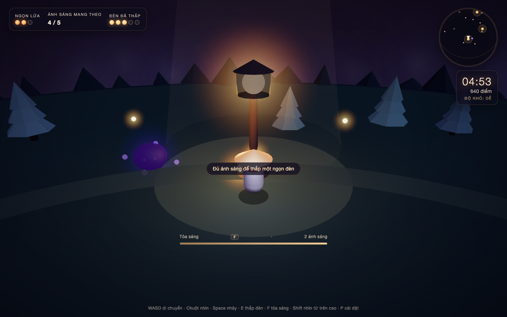

# Đảo Đèn Lồng — Phase 1

Game 3D góc nhìn thứ ba làm bằng **TypeScript + Three.js + Vite**, chạy trên macOS/Linux trong trình duyệt.
Một màn chơi: **Đêm 1 — Đảo Bến**. Bạn là Mây, gom đom đóm để thắp lại 5 Đèn Lồng Lớn trước khi hết đêm,
trong khi Bóng Mực đuổi theo trong sương đen.



## Chạy game (3 lệnh)

```bash
npm ci
npm run build
npm run dev
```

`npm run dev` tự mở `http://localhost:5173`. Cần Node.js 20 trở lên.

## Điều khiển

| Phím | Việc |
|---|---|
| `W A S D` | Di chuyển theo hướng camera |
| Chuột (nhấp vào màn chơi để khóa) | Xoay camera |
| `Space` | Nhảy (thuần hình ảnh, khoảng cách tính theo mặt phẳng XZ) |
| `E` | Nạp ánh sáng vào Đèn Lồng Lớn gần nhất |
| `F` | Tỏa sáng: làm choáng và đẩy Bóng Mực, tốn 2 ánh sáng |
| `M` | Bật/tắt âm thanh |
| `Esc` | Nhả chuột |

Mục tiêu: thắp đủ **5 đèn** trước khi hết **300 giây**. Mỗi đèn cần **3 đom đóm**.
Bóng Mực sợ vùng sáng quanh đèn đã thắp (bán kính 4 m). Bị chạm thì mất 1 ngọn lửa và rơi hết ánh sáng đang mang.

## Chế độ headless (Test Contract v1.0)

```bash
node dist-node/headless/main.js --seed 7 --night 1 --ticks 600 --out out.jsonl
node dist-node/headless/main.js --seed 3 --night 1 --ticks 120 \
  --scenario tests/scenarios/03-deposit.json \
  --inputs tests/scenarios/03-deposit.inputs.json \
  --out deposit.jsonl --snapshot-every 10
```

- Logic chạy đúng 60 tick/giây, không GPU, không cửa sổ.
- Đầu ra JSONL: `snapshot` (tick 0 rồi mỗi `--snapshot-every`), `event` ngay khi xảy ra, dòng cuối `end`.
- File scenario/inputs sai định dạng: thoát mã **2**, lỗi ra `stderr`. Lỗi CLI: mã **1**.
- Cùng seed + scenario + inputs cho ra file giống hệt nhau (đã kiểm chứng bằng so sánh byte).

`game.contract.json` ở gốc repo khai toàn bộ tuning. Test `tests/contract.test.ts` chặn việc file này lệch khỏi
`src/core/tuning.ts`.

### Các con số tuning

| Tham số | Giá trị | Ghi chú |
|---|---|---|
| `player_speed` | 6 m/s | |
| `carry_capacity` | 5 | |
| `lantern_cost` | 3 | đom đóm mỗi đèn |
| `pickup_radius` | 1.5 m | |
| `interact_radius` | 3 m | |
| `pulse_cost` | 2 | ánh sáng đang mang |
| `pulse_radius` | 8 m | |
| `night1_duration_s` | 300 | |
| `flames` | 3 | máu |
| `invuln_s` | 1.5 | bất tử sau khi bị chạm |
| `hit_drop_ratio` | 1 | rơi **toàn bộ** đom đóm đang mang |
| `pulse_stun_s` | 3 | |
| `pulse_push_m` | 4 | |
| `pulse_cooldown_s` | 2 | |
| `safe_radius` | 4 | quanh mỗi đèn đã thắp |
| `shade_speed` | 3.2 m/s | |
| `shade_hit_radius` | 1 m | |
| `fall_enabled` | false | không có rơi khỏi đảo; xem giả định A1 |

## Cách tính điểm

| Sự kiện | Điểm |
|---|---|
| Nhặt 1 đom đóm | +10 |
| Thắp 1 đèn | +100 |
| Làm choáng 1 Bóng Mực | +25 |
| Mỗi giây còn lại khi **thắng** | +5 |
| Mỗi ngọn lửa còn lại khi kết thúc | +50 |

Điểm trong snapshot giữa màn = điểm sự kiện (đom đóm, đèn, choáng). Hai khoản thưởng cuối màn chỉ cộng một lần
lúc `game_over`. Thưởng thời gian chỉ trả khi thắng, để thua sớm không được điểm cao.

Ví dụ thật (bot thắng, xem `docs/EVIDENCE.md`):
`39 đom đóm × 10 + 5 đèn × 100 + 31 lần choáng × 25 + 1 060 (thời gian) + 1 lửa × 50 = 2 775`.

## Giả định cho chỗ PRD-0 còn mơ hồ

| # | Giả định |
|---|---|
| A1 | `fall_enabled = false`. Đảo là đĩa bán kính 34 m; người chơi bị chặn mềm ở mép, không có sự kiện rơi. |
| A2 | Nạp đèn chỉ lấy **phần còn thiếu** (`lantern_cost − deposited`), tối đa bằng số đang mang; nạp một phần được giữ lại. |
| A3 | Tỏa sáng cần đủ 2 ánh sáng, trừ ngay khi bấm, luôn phát sự kiện `pulse` (kể cả `stunned_ids: []`). |
| A4 | Bị chạm rơi **toàn bộ** đom đóm đang mang (`hit_drop_ratio = 1`); số đom đóm rơi tan vào sương, không nhặt lại. |
| A5 | Nhảy chỉ đổi độ cao hiển thị. Mọi khoảng cách tính trên mặt phẳng XZ đúng như contract. |
| A6 | Bóng Mực luôn đuổi (`chase`); sau pulse thành `stunned` rồi trở lại `chase`. Chúng bị đẩy ra khỏi vùng `safe_radius` của đèn đã thắp và không thể gây sát thương khi ở trong vùng đó. |
| A7 | Thắng khi cả 5 đèn sáng (`all_lit`). Thua khi hết lửa (`no_flames`) hoặc hết đêm (`dawn`). |
| A8 | Thời gian hết mà đèn chưa sáng hết = thua `dawn` (bình minh đến khi đảo còn tối). |
| A9 | Đèn đặt sẵn `lit: true` trong scenario không cộng điểm và không phát sự kiện. |
| A10 | Ngoài contract: đom đóm sinh thêm mỗi 3 s (tối đa 16 con), Bóng Mực sinh thêm mỗi 12 s (tối đa 4 con), khởi đầu 12 đom đóm và 2 Bóng Mực cách xa người chơi 24–32 m. |
| A11 | Id tự sinh: `M1…` cho đom đóm, `S1…` cho Bóng Mực; scenario tự đánh số theo thứ tự khai báo. |
| A12 | `cam_yaw_deg` do người chơi điều khiển bằng chuột ở chế độ có giao diện; headless lấy đúng từ file inputs. |

## Sáng tạo của tôi

Phần thêm nằm ngoài lõi hoặc chỉ dùng đúng các tham số contract, nên đầu ra headless không đổi:

- **Đảo sáng dần**: cường độ ambient, sương và màu trời ấm lên theo số đèn đã thắp (chỉ renderer).
- **Vùng an toàn nhìn thấy được**: đĩa sáng quanh đèn đã thắp đúng bằng `safe_radius`, giúp người chơi hiểu vì sao Bóng Mực không vào.
- **Hiệu ứng**: vòng pulse lan tỏa, nhấp nháy bất tử, Bóng Mực có mắt và 4 vệt sương xoay, đom đóm lơ lửng.
- **Âm thanh procedural** bằng Web Audio (nhặt, nạp, thắp đèn, pulse, thắng/thua). Tắt hoàn toàn khi headless.
- **HUD có gợi ý theo ngữ cảnh**: còn thiếu bao nhiêu đom đóm, cooldown pulse, đồng hồ đổi màu khi còn dưới 60 giây.
- **Bot chơi tự động** (`npm run bot`) tạo file inputs; file này chạy lại qua CLI chính thức và thắng Đêm 1 — vừa là bằng chứng "chơi được tới thắng", vừa là test hồi quy.
- **Màn kết quả** hiển thị bảng điểm chi tiết theo từng nguồn điểm.

Bằng chứng phần cũ vẫn đúng sau khi thêm: 44 unit test và 10 kiểm tra contract đều đạt; `game.contract.json`
không đổi; output headless vẫn đúng định dạng và tất định.

## Cấu trúc

```
src/core/        logic game thuần, không DOM: tuning, rng, scenario, game, input-track
src/headless/    CLI đọc tham số, scenario, inputs và ghi JSONL
src/render/      Three.js: scene, HUD, âm thanh, vòng lặp 60 Hz cố định
tests/           unit test + scenario mẫu
scripts/         verify.mjs (kiểm tra contract), bot.ts (chơi tự động), shots.mjs (ảnh UI)
evidence/        bằng chứng: JSONL, báo cáo, ảnh chụp
docs/            SPEC, EVIDENCE, AI-LOG
```

## Kiểm chứng

```bash
npm test          # 44 unit test
npm run build
npm run verify    # 10 kiểm tra contract trên CLI đã build
npm run bot       # bot chơi và ghi evidence/phase-1/headless/bot-inputs.json
```

Kết quả và cách đọc: [docs/EVIDENCE.md](docs/EVIDENCE.md). Yêu cầu → tiêu chí nghiệm thu: [docs/SPEC.md](docs/SPEC.md).
Nhật ký dùng AI và retro: [docs/AI-LOG.md](docs/AI-LOG.md).

## Tài liệu của lab

Yêu cầu gốc và hướng dẫn lab vẫn giữ trong repo: [PHASE-1.md](PHASE-1.md), [GUIDE.md](GUIDE.md),
[CHECKPOINTS.md](CHECKPOINTS.md), [RUBRIC.md](RUBRIC.md), [RULES.md](RULES.md), [SUBMISSION.md](SUBMISSION.md).

## Giấy phép và nguồn

Xem [CREDITS.md](CREDITS.md). Toàn bộ mô hình, texture và âm thanh được tạo bằng code, không dùng asset ngoài.
