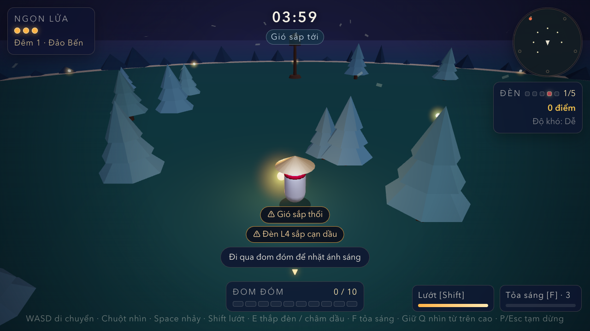

# Đảo Đèn Lồng — v1.0.0 "Bình minh"

Game 3D góc nhìn thứ ba làm bằng **TypeScript + Three.js + Vite**, chạy trên macOS/Linux trong trình duyệt
(khuyến nghị Chrome/Edge/Safari bản mới). Ba Đêm nối tiếp: **Đảo Bến**, **Đảo Cau**, **Đảo Chuông**. Bạn là
Mây, gom đom đóm để thắp và **giữ dầu** cho các Đèn Lồng Lớn tới bình minh, trong khi Bóng Mực đuổi theo và
hút cạn những ngọn đèn yếu.

Bản 1.0.0 thêm: **benchmark tự động**, **soak test 10 Đêm**, **bảng xếp hạng cục bộ**, **đổi phím**, **phụ đề**,
**giảm chuyển động**, **chữ lớn**, và đóng gói phát hành. Contract: **v1.3**.



## Yêu cầu hệ thống

- Node.js **20 trở lên** (đã thử với Node 22/26), npm 10+.
- RAM 8 GB; GPU hỗ trợ WebGL2.
- macOS, Linux hoặc Windows cho phần chơi. Benchmark dùng Chromium qua Playwright.
- Không cần GPU rời. Không cần mạng sau khi cài.

## Cài đặt và chơi (3 lệnh)

```bash
npm ci
npm run build
npm run dev
```

`npm run dev` mở `http://localhost:5173`. Đây là cách chơi khi phát triển.

Bản đã build, phục vụ tĩnh kèm API bảng xếp hạng:

```bash
npm run build
node dist-node/app.js          # http://127.0.0.1:4173
```

`run_cmd` trong contract là `node dist-node/app.js`. Thêm `--port 8080`, `--no-open`, `--data <file>`,
`--root <dir>` nếu cần.

## Điều khiển

| Hành động | Mặc định |
|---|---|
| Di chuyển | `W A S D` (hoặc phím mũi tên) |
| Nhìn | Chuột (nhấp vào màn chơi để khóa) |
| Nhảy | `Space` |
| Lướt | `Shift` |
| Thắp đèn / châm dầu | `E` |
| Tỏa sáng | `F` |
| Nhìn từ trên cao | Giữ `Q` (≥ 180 ms) |
| Tạm dừng | `P` hoặc `Esc` |
| Tắt/bật âm thanh | `M` |

**Mọi phím trên đều đổi được** trong Cài đặt → Phím điều khiển. Phím trùng bị từ chối kèm tên hành động
đang giữ phím; nút "Khôi phục mặc định" trả về bảng trên. `Esc` luôn dùng để huỷ/tạm dừng và không gán được.

## Ba Đêm

| Đêm | Đảo | Thời gian | Đèn | Cần sáng lúc bình minh | Đặc điểm |
|---|---|---|---|---|---|
| 1 | Đảo Bến | 240 s | 5 | 3 | Đảo tròn bán kính 40 m, rơi khỏi mép |
| 2 | Đảo Cau | 270 s | 6 | 4 | Hai đảo nối bằng cầu tre, 2 bục nhảy, Bùa Gió, Gió Lạc |
| 3 | Đảo Chuông | 300 s | 7 | 5 | Ba tầng, 2 dốc, tháp chuông, gió mạnh, 2 Bùa Gió |

Đèn mới thắp có **100 dầu**, hao **1 dầu/giây**. Tương tác `E` với đèn đang sáng để châm thêm 10 dầu mỗi
đom đóm. Đèn đã từng sáng chỉ cần **5 đom đóm** để thắp lại; đèn mới cần 10. Mỗi lần thắp thành công tăng
sức chứa thêm 2, tối đa 20.

Bóng Mực sợ vùng sáng bán kính 6 m quanh đèn `fuel ≥ 30`. Đèn yếu mất vùng an toàn; Bóng Mực `wander` tới
đứng cách 2 m và hút **5 dầu/giây**. Bị chạm mất 1 Ngọn Lửa, rơi nửa số đom đóm, bất tử 1.5 s. Rơi khỏi đảo
mất hết đom đóm và hồi sinh sau 1 s. Hết giờ mà chưa đủ đèn sáng, hoặc hết 3 Ngọn Lửa, là thua.

## Dễ tiếp cận

- **Đổi phím** cho 9 hành động, phát hiện trùng, lưu giữa các lần mở.
- **Phụ đề / chỉ báo hình ảnh** (`role="status"`, `aria-live="polite"`): Bóng Mực xuất hiện kèm mũi tên
  chỉ hướng ở mép màn hình, gió sắp thổi, "Còn 10 giây", đèn `fuel < 30`.
- **Giảm chuyển động**: tắt rung camera, tắt chớp màn hình khi bị đánh, đèn yếu không nhấp nháy 1 Hz.
- **Chữ lớn ×1.25**; mọi chữ UI tối thiểu **18 px** tại 1280×720 (đo tự động).
- **Bảng màu dễ phân biệt** (mù màu): Bóng Mực xanh lam `#00B3FF`, cảnh báo trắng kèm ⚠, đèn tắt xẹp 20%.

## Bảng xếp hạng cục bộ

Sau khi thua một Đêm hoặc sau màn Bình Minh, nhập tên để lưu điểm:

- Tên 3–12 ký tự, chỉ `[A-Za-z0-9_]`.
- Lưu `name`, `score` (tổng điểm các Đêm đã thắng), `nights_won` 0–3, `achieved_at` (ISO 8601 có múi giờ), `seed`.
- Top 10, điểm giảm dần, bằng điểm thì mục đạt trước đứng trên.
- Khi chạy `node dist-node/app.js`, dữ liệu nằm ở `data/leaderboard.json` (không commit). Khi phục vụ tĩnh,
  game dùng `localStorage` và không mất dữ liệu sau khi tải lại.
- Xem lại từ menu chính → **Bảng xếp hạng**.

Xuất ra file:

```bash
node dist-node/app.js --export-leaderboard out.json
# {"entries":[{"name":"May_01","score":858,"nights_won":1,"achieved_at":"...","seed":7}, ...]}
```

## Kiểm chứng

```bash
npm test          # 135 unit test (Vitest)
npm run typecheck # tsc --noEmit
npm run build     # headless + app server + UI (gồm bench.html)
npm run verify    # 35 kiểm tra trên CLI đã build, ghi evidence/phase-4/headless/
npm run bot       # bot thắng Đêm 1
```

`npm run verify` chạy lại toàn bộ Contract v1.0–v1.3: di chuyển, nhặt/nạp, Tỏa Sáng, bị đánh, thắng/thua,
dầu, thắp lại, tầng, gió, rơi, bục nhảy, determinism, hiệu năng, rồi thêm contract 1.3, soak, export bảng
xếp hạng, file hỏng, asset phát hành và `bench.json`.

## Headless (Test Contract v1.3)

```bash
node dist-node/headless/main.js --seed 7 --night 1 --ticks 600 --out out.jsonl
node dist-node/headless/main.js --seed 3 --night 2 --ticks 120 \
  --scenario tests/scenarios/16-jump-pad.json --out pad.jsonl --snapshot-every 10
node dist-node/headless/main.js --seed 5 --night 3 --ticks 18000 --out night3.jsonl
```

- 60 tick/giây, không GPU, không cửa sổ, tất định theo seed.
- JSONL: `snapshot` (tick 0 rồi mỗi `--snapshot-every`), `event` ngay khi xảy ra, dòng cuối `end`.
- Scenario/inputs sai định dạng: exit **2** + stderr. Lỗi CLI: exit **1**. Lỗi mô phỏng: exit **3**.
- Cùng seed + scenario + inputs cho file giống hệt nhau (kiểm chứng byte).

## Benchmark

```bash
npx playwright install chromium   # một lần
npm run bench -- --seed 42 --duration 30 --out bench.json
```

Cảnh chuẩn: cửa sổ 1280×720, Đêm 1, 200 Bóng Mực `wander`, 100 đom đóm, L1–L3 sáng 100 dầu, camera quỹ
đạo bán kính 30 m ở cao 15 m, 15 s/vòng, 3 s khởi động không đo. Script tự thoát mã 0, ghi `bench.json`.

Bản ghi gần nhất trên Apple M1 Pro / macOS 27 / Chromium 153:

| Trường | Giá trị | Ngưỡng |
|---|---|---|
| `avg_fps` | **217.95** | ≥ 60 |
| `p1_low_fps` | **158.77** | ≥ 30 |
| `frame_ms_p95` | 5.3 ms | — |
| `load_ms` | **1230 ms** | ≤ 10 000 |
| `frames` | 6539 | — |
| `peak_mem_mb` | 1224 | — |

`peak_mem_mb` là tổng RSS cây tiến trình Chromium (shared page tính theo từng tiến trình), `null` trên
Windows. `vsync_off` báo việc đã truyền `--disable-gpu-vsync --disable-frame-rate-limit`; một số compositor
vẫn khoá 60 Hz và khi đó `avg_fps ≈ 60`, vẫn đạt ngưỡng. Chi tiết công thức và máy đo: [docs/BENCHMARK.md](docs/BENCHMARK.md).

## Soak test

```bash
npm run soak -- --seed 7 --nights 10 --out soak.json
# hoặc: node dist-node/headless/soak.js --seed 7 --nights 10 --out soak.json
```

10 Đêm liên tiếp trong một tiến trình, thứ tự 1→2→3, Đêm `i` dùng seed `7+i`, input ngẫu nhiên theo seed.
Kết quả gần nhất: `crashes 0`, `mem_start_mb 56 → mem_end_mb 63` (1.13×, ngưỡng 1.2×), `duration_s 0.3`.
Trước khi lấy `mem_start_mb`, một Đêm khởi động nóng bị bỏ đi và cả hai mốc đều gọi GC, để số đo phản ánh
bộ nhớ trò chơi thay vì mã máy ảo.

## Tuning (Contract v1.3)

| Tham số | Giá trị | Ghi chú |
|---|---|---|
| `player_speed` | 6 m/s | tăng/giảm tốc trong 0.1 s |
| `carry_capacity` / `capacity_max` | 10 / 20 | nền + 2 mỗi lần thắp |
| `lantern_cost` / `relight_cost` | 10 / 5 | đèn mới / đèn đã từng sáng |
| `fuel_max` / `fuel_decay_per_s` | 100 / 1 | tính 1/60 mỗi tick |
| `fuel_per_mote` | 10 | khi châm dầu |
| `drain_per_s` | 5 | mỗi Bóng Mực đang hút |
| `low_fuel_threshold` | 30 | dưới ngưỡng: mất vùng an toàn |
| `win_ratio` | 0.6 | `ceil(0.6 × tổng)` đèn sáng lúc bình minh |
| `pickup_radius` / `interact_radius` | 1 / 2 m | XZ, chênh cao ≤ 1.5 m |
| `pulse_cost` / `pulse_radius` | 3 / 5 m | khoảng cách 3D tới tâm Bóng Mực |
| `dash_speed` / `dash_duration_s` / `dash_cooldown_s` | 14 / 0.2 / 1.5 | |
| `night1_/night2_/night3_duration_s` | 240 / 270 / 300 | |
| `flames` / `invuln_s` / `hit_drop_ratio` | 3 / 1.5 / 0.5 | |
| `pulse_stun_s` / `pulse_push_m` / `pulse_cooldown_s` | 2 / 4 / 3 | |
| `safe_radius` / `shade_speed` / `shade_hit_radius` | 6 / 4.0 / 1.0 | Đêm 3: 4.5 m/s |
| `fall_enabled` | true | rơi khỏi đảo |

Ngoài contract (`PHYSICS`): nhảy 7 m/s, trọng lực 20 m/s², gia tốc mặt đất 60 m/s², điều khiển trên không
40%, trần đom đóm 30, TTL đom rơi 480 tick, Bùa Gió 600 tick, respawn 2700 tick.

## Cách tính điểm

| Sự kiện | Điểm |
|---|---|
| Nạp hoặc châm 1 đom đóm vào đèn | +5 |
| Thắp lần đầu / thắp lại | +100 / +40 |
| Mỗi Bóng Mực trúng Tỏa Sáng | +5 |
| Bóng Mực trúng Tỏa Sáng khi đang `drain` | +15 thêm |
| Khi thắng: mỗi đèn còn sáng | `+50 + floor(fuel)` |
| Khi thắng: mỗi Ngọn Lửa còn lại | +50 |

Tổng điểm chiến dịch = tổng điểm các Đêm đã thắng. Không còn thưởng thời gian.

## Sáng tạo của tôi

Phần thêm nằm ngoài lõi hoặc chỉ đọc trạng thái, nên đầu ra headless không đổi. Trong cảnh benchmark, mọi
thứ không ảnh hưởng số đo đều tắt theo luật của cảnh chuẩn.

- Ba hòn đảo dựng hoàn toàn bằng code: cầu tre, ba tầng, dốc, bục nhảy phát sáng, tháp chuông.
- Thanh dầu trên từng đèn; nhấp nháy 1 Hz khi dầu dưới 30 (tắt khi Giảm chuyển động).
- Đảo sáng dần theo số đèn còn sáng; vùng an toàn chỉ hiện quanh đèn đủ dầu.
- Hiệu ứng: vòng pulse, bất tử nhấp nháy, Bóng Mực có mắt và 4 vệt sương, Gió Lạc, Bùa Gió, lá bay.
- Âm thanh procedural bằng Web Audio, nhạc đổi theo Đêm.
- HUD đầy đủ, minimap v1.2, chiến dịch 3 Đêm, tạm dừng, cài đặt lưu trong `localStorage`.
- Phụ đề, mũi tên mép màn hình, đổi phím, giảm chuyển động, chữ lớn.
- Bot tự chơi (`npm run bot`) thắng Đêm 1.

Ảnh: `evidence/phase-4/ui/` — menu, cài đặt, xung đột phím, phụ đề trong HUD, bảng xếp hạng, form lưu điểm,
chữ lớn. Ảnh Phase 3 vẫn giữ trong `evidence/phase-3/ui/`.

## Cấu trúc

```
src/core/        logic thuần: tuning, physics, rng, scenario, nights, terrain, game, leaderboard, bench-scenario
src/headless/    CLI JSONL + soak runner
src/server/      server tĩnh dist/ + API leaderboard + export CLI
src/bench/       trang benchmark (bench.html)
src/render/      Three.js: world, HUD, minimap, alerts, keybinds, settings, audio, chiến dịch 60 Hz
tests/           135 unit test + scenario mẫu
scripts/         verify.mjs (35 kiểm tra), bench.mjs, bench-stats.mjs, bot.ts, shots.mjs
evidence/        bằng chứng phase-1..4
docs/            SPEC, EVIDENCE, AI-LOG, RETRO, BENCHMARK, ADR, CHANGELOG, demo
release/         gói phát hành (sinh ra, không commit)
```

## Tài liệu

- Yêu cầu → tiêu chí nghiệm thu: [docs/SPEC.md](docs/SPEC.md)
- Bằng chứng và cách đọc: [docs/EVIDENCE.md](docs/EVIDENCE.md)
- Nhật ký dùng AI, retro 4 phase: [docs/AI-LOG.md](docs/AI-LOG.md), [docs/RETRO.md](docs/RETRO.md)
- Benchmark: [docs/BENCHMARK.md](docs/BENCHMARK.md)
- Quyết định thiết kế: [docs/adr/0001-lantern-fuel-and-dawn.md](docs/adr/0001-lantern-fuel-and-dawn.md)
- Thay đổi phá vỡ tương thích: [CHANGELOG.md](CHANGELOG.md)
- Yêu cầu gốc của lab: [docs/phase/PHASE-1.md](docs/phase/PHASE-1.md) … [PHASE-4.md](docs/phase/PHASE-4.md)

## Giấy phép

[MIT](LICENSE). Xem [CREDITS.md](CREDITS.md). Toàn bộ mô hình, texture và âm thanh tạo bằng code, không
dùng asset ngoài.
