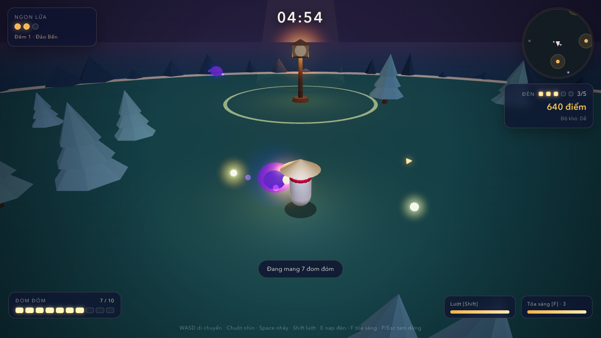

# Đảo Đèn Lồng — Phase 2 "Ba hòn đảo"

Game 3D góc nhìn thứ ba làm bằng **TypeScript + Three.js + Vite**, chạy trên macOS/Linux trong trình duyệt.
Ba Đêm nối tiếp: **Đảo Bến**, **Đảo Cau**, **Đảo Chuông**. Bạn là Mây, gom đom đóm để thắp lại các
Đèn Lồng Lớn trước khi hết đêm, trong khi Bóng Mực đuổi theo trong sương đen.



## Chạy game (3 lệnh)

```bash
npm ci
npm run build
npm run dev
```

`npm run dev` tự mở `http://localhost:5173`. Cần Node.js 20 trở lên.

## Điều khiển

| Phím | Việc |
|---|---|
| `W A S D` | Di chuyển theo hướng camera |
| Chuột (nhấp vào màn chơi để khóa) | Xoay camera |
| `Space` | Nhảy (7 m/s, chỉ khi chạm đất) |
| `Shift` | Lướt 14 m/s trong 0.2 s, hồi chiêu 1.5 s |
| `E` | Nạp ánh sáng vào Đèn Lồng Lớn gần nhất (10 đom đóm) |
| `F` | Tỏa sáng: làm choáng và đẩy Bóng Mực, tốn 3 đom đóm |
| `M` | Bật/tắt âm thanh |
| `P` / `Esc` | Tạm dừng: Tiếp tục · Chơi lại Đêm · Cài đặt · Về menu |

## Ba Đêm

| Đêm | Đảo | Thời gian | Đèn | Đặc điểm |
|---|---|---|---|---|
| 1 | Đảo Bến | 300 s | 5 | Đảo tròn bán kính 40 m, rơi khỏi mép |
| 2 | Đảo Cau | 330 s | 6 | Hai đảo nối bằng cầu tre, 2 bục nhảy, Bùa Gió, Gió Lạc |
| 3 | Đảo Chuông | 360 s | 7 | Ba tầng, 2 dốc, tháp chuông, gió mạnh, 2 Bùa Gió |

Mỗi đèn cần **10 đom đóm**, nạp được nhiều lần. Bóng Mực sợ vùng sáng bán kính 6 m quanh đèn đã thắp.
Bị chạm mất 1 Ngọn Lửa, rơi nửa số đom đóm, bất tử 1.5 s. Rơi khỏi đảo mất hết đom đóm và hồi sinh sau
1 s. Hết 3 Ngọn Lửa hoặc hết đêm khi đèn chưa sáng hết là thua. Thắng cả ba Đêm để xem Bình Minh và
tổng điểm chiến dịch.

## Chế độ headless (Test Contract v1.1)

```bash
node dist-node/headless/main.js --seed 7 --night 1 --ticks 600 --out out.jsonl
node dist-node/headless/main.js --seed 3 --night 2 --ticks 120 \
  --scenario tests/scenarios/16-jump-pad.json --out pad.jsonl --snapshot-every 10
node dist-node/headless/main.js --seed 5 --night 3 --ticks 21600 --out night3.jsonl
```

- Logic chạy đúng 60 tick/giây, không GPU, không cửa sổ.
- Đầu ra JSONL: `snapshot` (tick 0 rồi mỗi `--snapshot-every`), `event` ngay khi xảy ra, dòng cuối `end`.
- File scenario/inputs sai định dạng: thoát mã **2**, lỗi ra `stderr`. Lỗi CLI: mã **1**.
- Cùng seed + scenario + inputs cho ra file giống hệt nhau (kiểm chứng byte).
- Full Đêm 3 (21 600 tick) chạy ~0.15 s, dưới giới hạn 30 s.

`game.contract.json` ở gốc repo khai toàn bộ tuning v1.1. Test `tests/contract.test.ts` chặn việc file
này lệch khỏi `src/core/tuning.ts`.

### Các con số tuning

| Tham số | Giá trị | Ghi chú |
|---|---|---|
| `player_speed` | 6 m/s | tăng/giảm tốc trong 0.1 s |
| `carry_capacity` | 10 | |
| `lantern_cost` | 10 | đom đóm mỗi đèn |
| `pickup_radius` | 1.0 m | XZ, chênh cao ≤ 1.5 m |
| `interact_radius` | 2.0 m | XZ, cùng tầng (chênh cao ≤ 1.5 m) |
| `pulse_cost` | 3 | |
| `pulse_radius` | 5 m | khoảng cách 3D tới tâm Bóng Mực |
| `dash_speed` / `dash_duration_s` / `dash_cooldown_s` | 14 m/s / 0.2 s / 1.5 s | |
| `night1_duration_s` / `night2_duration_s` / `night3_duration_s` | 300 / 330 / 360 | |
| `flames` | 3 | hồi đầy mỗi Đêm |
| `invuln_s` | 1.5 | 90 tick |
| `hit_drop_ratio` | 0.5 | rơi `floor(mang / 2)` |
| `pulse_stun_s` | 2 | 120 tick |
| `pulse_push_m` | 4 | trong 15 tick đầu |
| `pulse_cooldown_s` | 3 | |
| `safe_radius` | 6 | quanh mỗi đèn đã thắp |
| `shade_speed` | 4.0 m/s | Đêm 3: 4.5 m/s |
| `shade_hit_radius` | 1.0 m | XZ, chênh cao ≤ 1.5 m |
| `fall_enabled` | true | rơi khỏi đảo |

Ngoài contract (trong `PHYSICS`): nhảy 7 m/s, trọng lực 20 m/s², gia tốc mặt đất 60 m/s², điều khiển
trên không 40%, trần đom đóm 30, TTL đom rơi 480 tick, Bùa Gió 600 tick, respawn 2700 tick.

## Cách tính điểm

| Sự kiện | Điểm |
|---|---|
| Nạp 1 đom đóm vào đèn | +10 |
| Thắp 1 đèn | +100 |
| Mỗi Bóng Mực trúng Tỏa Sáng (kể cả đang choáng) | +5 |
| Khi thắng: mỗi giây còn lại | +2 |
| Khi thắng: mỗi Ngọn Lửa còn lại | +50 |

Điểm trong snapshot giữa màn là điểm sự kiện. Hai khoản thưởng cuối màn chỉ cộng khi **thắng**.
Tổng điểm chiến dịch = tổng điểm các Đêm đã thắng.

Ví dụ thật (bot thắng Đêm 1, xem `evidence/phase-2/headless/bot-summary.json`):
`50 đom đóm × 10 + 5 đèn × 100 + 6 lần choáng × 5 + 76 giây × 2 + 3 lửa × 50 = 1 332`.

## Giả định cho chỗ PHASE-2 còn mơ hồ

| # | Giả định |
|---|---|
| A1 | Điểm đom đóm cộng lúc **nạp** vào đèn, đúng chữ "nạp" của Contract v1.1. |
| A2 | Hướng mặt ban đầu theo hướng xuất phát của Đêm (+Z); sau đó là hướng di chuyển gần nhất. |
| A3 | Điều khiển trên không = 40% gia tốc mặt đất; lướt trên không giữ nguyên độ cao. |
| A4 | Tâm Bóng Mực ở `groundHeight + 1.0`; Gió Lạc ở `groundHeight + 1.6`. |
| A5 | Vùng an toàn và phát hiện Bóng Mực dùng XZ, chỉ tính khi cùng tầng (chênh cao ≤ 2 m). |
| A6 | Bóng Mực `spawning` 30 tick, `wander` 2 m/s; recoil 60 tick đẩy 2 m. |
| A7 | Gió mạnh bắt đầu ở giây 30, 60, …; cảnh báo từ giây 28; hướng RNG mỗi cơn. |
| A8 | Đèn và đom đóm cùng tầng mới tương tác được; nạp xuyên tầng bị chặn. |
| A9 | Đom đóm rơi nhặt lại được từ tick sau, TTL 480 tick; rơi khỏi đảo thì mất hẳn. |
| A10 | Tạm dừng trong trình duyệt ngừng gọi `step()`; lõi vẫn hỗ trợ input `pause` cho headless. |
| A11 | `fall_enabled` giữ trong contract với giá trị `true`; hằng số vật lý ngoài contract không vào JSON. |
| A12 | Bot dùng cùng luật chuẩn, không chỉnh tuning, không dùng scenario riêng khi chơi. |

## Sáng tạo của tôi

Phần thêm nằm ngoài lõi hoặc chỉ đọc trạng thái, nên đầu ra headless không đổi:

- **Ba hòn đảo dựng hoàn toàn bằng code**: cầu tre, ba tầng, dốc, bục nhảy phát sáng, tháp chuông.
- **Đảo sáng dần**: ambient, sương và màu trời ấm lên theo số đèn đã thắp (đúng công thức Phần 3.8).
- **Vùng an toàn nhìn thấy được**: vòng sáng quanh đèn đã thắp đúng bán kính 6 m.
- **Hiệu ứng**: vòng pulse lan tỏa, bất tử nhấp nháy, Bóng Mực có mắt và 4 vệt sương, Gió Lạc là dải lụa
  xám xanh, Bùa Gió đỏ viền vàng, lá bay khi gió mạnh, đom đóm rơi khác màu.
- **Âm thanh procedural** bằng Web Audio: nhạc nền đổi theo Đêm, hiệu ứng nhặt/nạp/thắp/pulse/bị đánh/
  nhảy/lướt/Bùa Gió/Gió Lạc/Bóng Mực xuất hiện/đếm ngược/thắng/thua.
- **HUD đầy đủ**: lửa, đồng hồ `mm:ss` đỏ ≤ 30 s, đèn k/n + điểm, thanh 10 ô, hồi chiêu Lướt/Tỏa Sáng,
  nhắc `E — Nạp ánh sáng (x/10)`, mũi tên chỉ đèn ngoài màn hình, nhãn gió và Bùa Gió.
- **Chiến dịch 3 Đêm** với menu, màn giới thiệu lời Ông Đăng, màn kết quả từng Đêm, Bình Minh và tổng điểm.
- **Tạm dừng bằng chuột** (`P`/`Esc`) có Tiếp tục / Chơi lại Đêm / Cài đặt / Về menu; cài đặt âm lượng và
  độ nhạy chuột lưu trong `localStorage`.
- **Mini-map v1.1**: vẽ hình đảo/cầu/tầng, đom đóm, Bóng Mực, Gió Lạc, Bùa Gió, vùng an toàn, hướng gió.
- **Bot chơi tự động** (`npm run bot`) thắng Đêm 1 với số chuẩn và tạo inputs replay được qua CLI.

Ảnh minh họa: `evidence/phase-2/ui/01-menu.png` (menu), `02-intro-night1.png` (giới thiệu),
`04-night1-lit.png` (Đêm 1), `05-pause.png` (tạm dừng), `06-settings.png` (cài đặt),
`08-night2-bridge.png` (Đêm 2), `09-night3.png` (Đêm 3), `10-sunrise.png` (Bình Minh).

## Cấu trúc

```
src/core/        logic game thuần: tuning, physics, rng, scenario, nights, terrain, game, input-track
src/headless/    CLI đọc tham số, scenario, inputs và ghi JSONL
src/render/      Three.js: world theo Đêm, HUD, mini-map, cài đặt, âm thanh, chiến dịch 60 Hz
tests/           unit test + scenario mẫu cho từng tính năng
scripts/         verify.mjs (24 kiểm tra), bot.ts (chơi tự động), shots.mjs (ảnh UI)
evidence/        bằng chứng phase-1 và phase-2
docs/            SPEC, EVIDENCE, AI-LOG, thiết kế + kế hoạch phase-2
```

## Kiểm chứng

```bash
npm test          # 78 unit test
npm run build
npm run verify    # 24 kiểm tra contract trên CLI đã build
npm run bot       # bot thắng Đêm 1, ghi evidence/phase-2/headless/bot-inputs.json
```

Kết quả và cách đọc: [docs/EVIDENCE.md](docs/EVIDENCE.md). Yêu cầu → tiêu chí nghiệm thu:
[docs/SPEC.md](docs/SPEC.md). Nhật ký dùng AI và retro: [docs/AI-LOG.md](docs/AI-LOG.md).

## Tài liệu của lab

Yêu cầu gốc và hướng dẫn lab vẫn giữ trong repo: [docs/phase/PHASE-1.md](docs/phase/PHASE-1.md), [GUIDE.md](GUIDE.md),
[CHECKPOINTS.md](CHECKPOINTS.md), [RUBRIC.md](RUBRIC.md), [RULES.md](RULES.md), [SUBMISSION.md](SUBMISSION.md).

## Giấy phép và nguồn

Xem [CREDITS.md](CREDITS.md). Toàn bộ mô hình, texture và âm thanh được tạo bằng code, không dùng asset ngoài.
